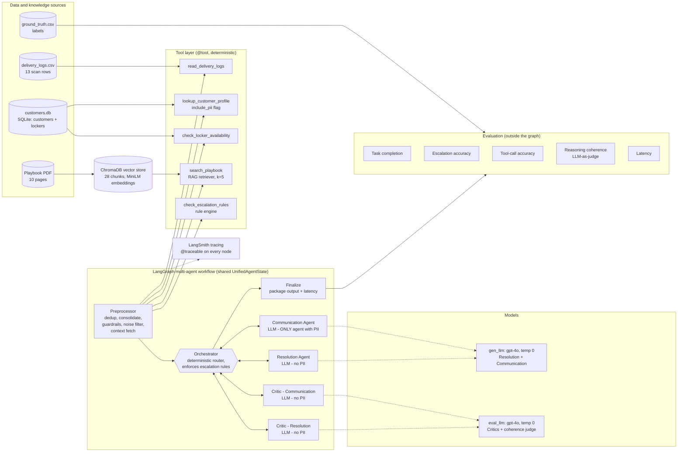
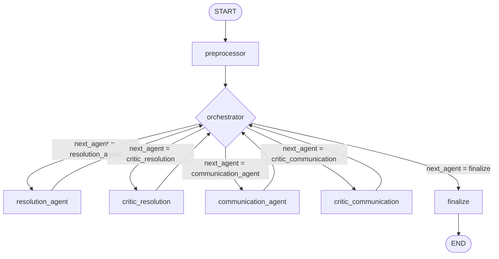
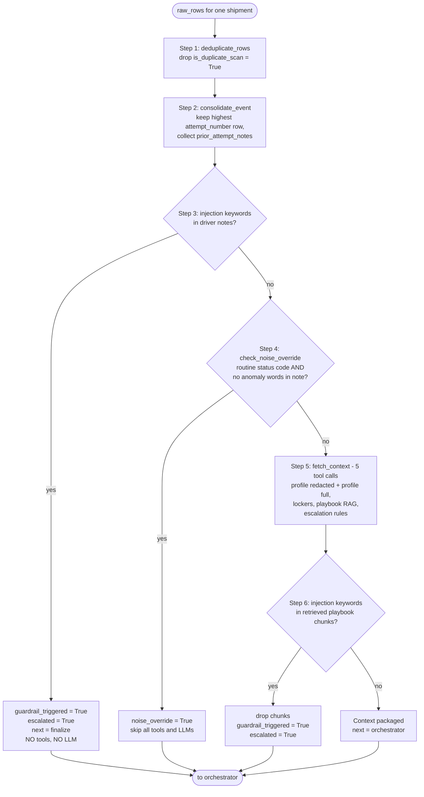
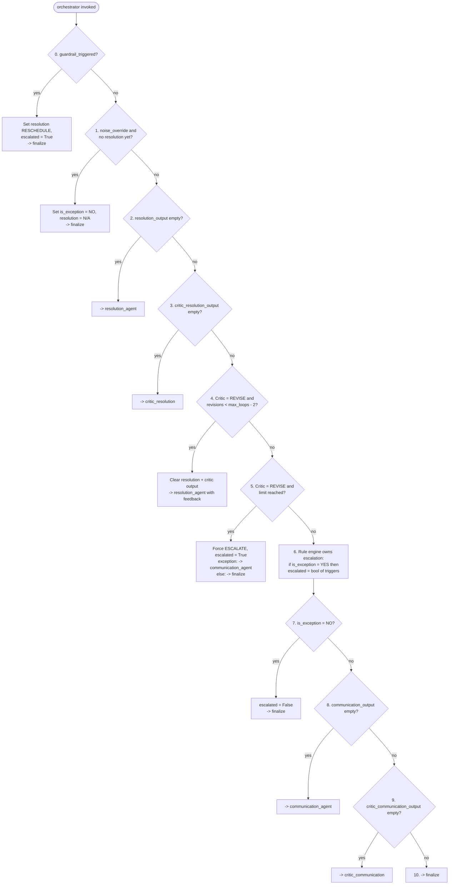
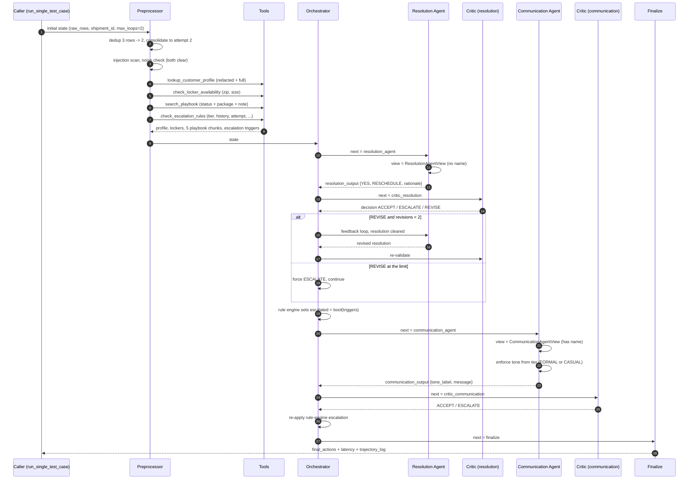
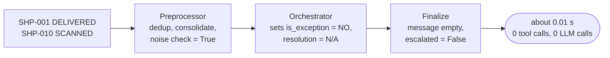
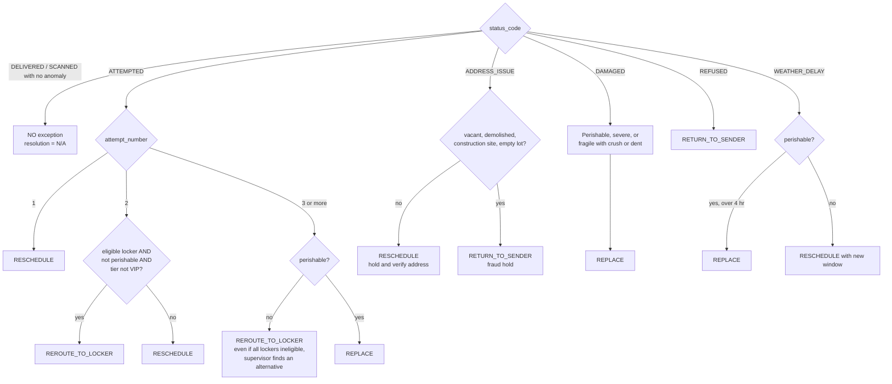

# AI-Powered Last-Mile Delivery Exception Handling (Project 3)

A proof of concept (POC) of a **multi-agent system** that watches raw delivery scan logs, filters out routine noise, decides what to do about each real delivery exception, writes the customer notification, and escalates to a human supervisor when policy says it must.

- **Main deliverable:** `Project_3_Full_code_Notebook_ajith.ipynb` (executed notebook) and `Project_3_Full_code_Notebook_ajith.html` (export for submission)
- **Stack:** Python, LangGraph (workflow), LangChain + OpenAI `gpt-4o` (LLM), ChromaDB + HuggingFace `all-MiniLM-L6-v2` (RAG), SQLite (customer and locker data), Pydantic (structured output), LangSmith (observability)
- **Final run result:** 10/10 task completion, 100% escalation accuracy, 100% tool-call accuracy, 5.00/5 mean coherence, 4.39 s mean latency (see [Results](#9-results)).

---

## Table of contents

1. [Business problem](#1-business-problem)
2. [Inputs: data and knowledge sources](#2-inputs-data-and-knowledge-sources)
3. [High-level architecture](#3-high-level-architecture)
4. [Detailed flow diagrams](#4-detailed-flow-diagrams)
5. [Component reference](#5-component-reference)
6. [Security and guardrails](#6-security-and-guardrails)
7. [Evaluation framework](#7-evaluation-framework)
8. [The 10 test cases](#8-the-10-test-cases)
9. [Results](#9-results)
10. [Notebook walkthrough (cell by cell)](#10-notebook-walkthrough)
11. [How to run](#11-how-to-run)
12. [Design decisions, limitations and next steps](#12-design-decisions-limitations-and-next-steps)
13. [Repository layout](#13-repository-layout)
14. [Glossary](#14-glossary)

---

## 1. Business problem

Roughly **10% of last-mile shipments hit an exception** (failed attempt, address issue, damage, refusal, weather delay). The same status code can mean different things depending on context. For example, `ATTEMPTED` could mean *reschedule*, *reroute to a locker*, or *escalate to a supervisor*, depending on:

- the **attempt number**,
- the **customer tier** (VIP / PREMIUM / STANDARD),
- the customer's **exceptions in the last 90 days**,
- the **package type** (perishable, fragile, standard), and
- whether a **locker** in that zip code can actually take the package.

Human dispatchers handle this today by reading an operations playbook. They treat a VIP's perishable and a standard customer's first miss the same way, and they are slow. Failed deliveries drive churn, so this is really a **retention problem disguised as a dispatch problem**.

**Objective:** build an AI system that, for every shipment, does the following:

1. Ignores noise (delivered, routine scans) without spending any LLM tokens.
2. Classifies real exceptions.
3. Picks exactly one of four resolutions: `RESCHEDULE`, `REROUTE_TO_LOCKER`, `REPLACE`, `RETURN_TO_SENDER`.
4. Writes a customer message in the right tone (formal for VIP/PREMIUM, casual for STANDARD).
5. Escalates to a supervisor using deterministic business rules.
6. Leaves an auditable trail of every decision.

---

## 2. Inputs: data and knowledge sources

All files live in `Project 3 - AI-powered Last Mile Delivery Exception Handling Automation - Data Files/`.

| File | Type | Content | Used by |
|---|---|---|---|
| `delivery_logs.csv` | CSV | 13 scan rows covering 10 shipments. 2 rows are duplicate scans (SHP-002, SHP-007). Columns: `shipment_id, timestamp, status_code, status_description, customer_id, delivery_address, package_type, package_size, attempt_number, is_duplicate_scan` | Preprocessor (via `read_delivery_logs`) |
| `ground_truth.csv` | CSV | Expected labels per shipment: `is_exception`, `expected_resolution`, `should_escalate`, `expected_tone`, reasoning | Evaluation only. Never seen by agents. |
| `customers.db` -> `customers` | SQLite | 12 customers: tier, preferred channel (EMAIL/SMS), `exceptions_last_90d`, `active_credit`, name (**PII**) | `lookup_customer_profile` |
| `customers.db` -> `lockers` | SQLite | 6 lockers: zip code, max package size, capacity status (AVAILABLE / LIMITED / FULL), address, hours | `check_locker_availability` |
| `exception_resolution_playbook.pdf` | PDF (10 pages) | Human dispatcher manual in natural language: failed attempts, address issues, damage, refusals, weather, locker reroute, escalation matrix, communication guidelines | RAG: chunked, embedded, stored in ChromaDB, searched by `search_playbook` |
| `config.json` | JSON | OpenAI key and base URL, LangSmith key and project | Notebook setup. **Secret: never commit or share it.** |

Status codes in the data: `ATTEMPTED`, `ADDRESS_ISSUE`, `DAMAGED`, `REFUSED`, `WEATHER_DELAY` (exceptions), and `DELIVERED`, `SCANNED` (noise).

---

## 3. High-level architecture

The system is a **LangGraph state machine** built around a **hub-and-spoke orchestrator**. A deterministic **preprocessor** runs first and cleans, enriches and guards the input. A deterministic **orchestrator** is the only router. Four LLM-backed specialists do the reasoning. A **finalize** node packages the result. Evaluation runs outside the graph, comparing the output to ground truth.



### Architecture in one paragraph

Raw scan rows enter the graph. The **Preprocessor** removes duplicates, merges multi-attempt shipments into one event, scans for prompt injection, and short-circuits routine noise. For real exceptions it calls all five tools to build context. The **Orchestrator** then drives a fixed sequence: Resolution Agent -> Resolution Critic (with up to 2 revision loops) -> Communication Agent -> Communication Critic -> Finalize. **Escalation is decided by the deterministic rule engine, not by any LLM**, and the orchestrator re-enforces it after the model steps. Each agent sees only a typed **view** of the shared state, which is how PII isolation is enforced.

### Key architectural ideas

| Idea | How it is implemented |
|---|---|
| **Hub-and-spoke control** | Every node returns to the `orchestrator`. Only it chooses the next node (`route_from_orchestrator`). |
| **Cost control** | Noise shipments (`DELIVERED`, `SCANNED`, ...) never reach a tool or an LLM (~0.01 s). |
| **Least privilege / PII isolation** | Five typed view dataclasses plus `project_into` / `merge_back`. Names are stripped at the tool boundary (`include_pii=False`). |
| **Deterministic where it must be** | Dedup, noise detection, escalation rules, locker eligibility and routing are plain code. LLMs only classify, choose, write and judge. |
| **Structured, validated output** | Pydantic schemas with `Literal` types and a cross-field validator, plus retries and safe fallbacks. |
| **Self-correction** | A Critic can send the Resolution Agent back with feedback (max 2 loops, then forced escalation). |
| **Auditability** | `trajectory_log` and `tool_calls_log` record each step. The state is also traced in LangSmith. |

---

## 4. Detailed flow diagrams

### 4.1 End-to-end workflow (graph topology)

This is the graph compiled by `StateGraph(UnifiedAgentState)`. Solid arrows are fixed edges. The orchestrator's outgoing arrows are the conditional edges.



### 4.2 Preprocessor: six-step pipeline

The preprocessor is entirely deterministic apart from the vector search. Early exits save tool and LLM cost and block unsafe input before any model sees it.



Noise status codes: `DELIVERED`, `IN_TRANSIT`, `OUT_FOR_DELIVERY`, `SCANNED`. They count as noise only if the driver note has none of the anomaly words (`damage`, `leak`, `delay`, `lost`, `fraud`, ...).

### 4.3 Orchestrator: decision logic (priority order)

The orchestrator runs after **every** node and applies these rules top to bottom. The first match wins.



> **Important:** step 6 runs on every pass, including after the Communication Critic. So an LLM critic cannot create an escalation the rules did not trigger, and it cannot waive one the rules did trigger.

### 4.4 Exception path: sequence diagram

A typical exception such as SHP-002 (VIP, second attempt, duplicate scan):



### 4.5 Noise path (cost saver)



### 4.6 Resolution decision rules (what the Resolution Agent applies)



### 4.7 Escalation rule matrix (deterministic, `check_escalation_rules`)

| Type | Trigger |
|---|---|
| **Automatic** | 3rd (or later) failed attempt, any tier |
| **Automatic** | VIP customer with >= 3 exceptions in 90 days |
| **Automatic** | `DAMAGED` + `PERISHABLE` |
| **Automatic** | `WEATHER_DELAY` + `PERISHABLE` with delay > 4 hours (hours parsed by regex from free text) |
| **Automatic** | `ADDRESS_ISSUE` with fraud words (vacant / demolished / construction site / empty lot) |
| **Discretionary** | STANDARD customer with > 5 exceptions in 90 days |
| **Discretionary** | PREMIUM customer, perishable, weather delay |

If the list of triggers is non-empty for an exception, the shipment is escalated. Otherwise it is not.

---

## 5. Component reference

### 5.1 Shared state: `UnifiedAgentState` (TypedDict)

One dictionary travels through the graph. Field groups:

| Group | Fields |
|---|---|
| Input | `raw_rows`, `shipment_id` |
| Preprocessor output | `consolidated_event`, `customer_profile` (redacted), `customer_profile_full` (with name), `locker_availability`, `playbook_context`, `escalation_signals`, `noise_override`, `guardrail_triggered` |
| Resolution | `resolution_output {is_exception, resolution, rationale}` |
| Resolution critic | `critic_resolution_output {decision, rationale}`, `resolution_revision_count`, `critic_feedback` |
| Communication | `communication_output {tone_label, communication_message}` |
| Communication critic | `critic_communication_output {decision, rationale}` |
| Routing | `next_agent`, `max_loops` (=2) |
| Final / audit | `escalated`, `tool_calls_log`, `trajectory_log`, `start_time`, `latency_sec`, `final_actions` |

### 5.2 Agent views (least-privilege access)

`project_into(state, ViewClass)` gives an agent only the fields in its view. `merge_back(state, output, ViewClass)` writes back only the fields in that view.

| View | Can read | Owns (writes) | Sees customer name? |
|---|---|---|---|
| `RouterView` (preprocessor, orchestrator, finalize) | everything | everything | yes (holds both profiles) |
| `ResolutionAgentView` | event, **redacted** profile, lockers, playbook, escalation signals, critic feedback | `resolution_output` | **No** |
| `CommunicationAgentView` | event, **full** profile, lockers, resolution | `communication_output` | **Yes (only agent that uses it)** |
| `CriticResolutionView` | event, redacted profile, lockers, playbook, signals, resolution | `critic_resolution_output` | No |
| `CriticCommunicationView` | event, redacted profile, resolution, communication | `critic_communication_output` | Not directly, but it reads the generated message, which contains the name |

### 5.3 Tools (all in the preprocessor's `fetch_context` except the log reader)

| Tool | Input | Output | Notes |
|---|---|---|---|
| `read_delivery_logs()` | none | list of CSV rows (dicts) | Used when building test inputs |
| `lookup_customer_profile(customer_id, include_pii=False)` | customer id | profile dict | Pops `name` unless `include_pii=True` |
| `check_locker_availability(zip_code, package_size)` | zip, size | lockers with `eligible` and `reason` | Not eligible if: too small for the package, FULL, or LIMITED with a non-SMALL package |
| `search_playbook(query)` | free-text query | 5 chunks with `content` and `page` | Chroma retriever, k=5. Page numbers feed the citations. |
| `check_escalation_rules(...)` | tier, history, attempt, package type, status, description | `{has_triggers, trigger_count, triggers[]}` | **No LLM.** Pure rules. |

### 5.4 Agents

| Node | Model | Output schema | Behaviour |
|---|---|---|---|
| **Preprocessor** | none | n/a | Six-step deterministic pipeline (see 4.2) |
| **Orchestrator** | none | n/a | Deterministic router, priority list (see 4.3) |
| **Resolution Agent** | `gen_llm` (gpt-4o) | `ResolutionOutput` (`is_exception` YES/NO, `resolution` enum, `rationale`) with a validator: YES needs a real action, NO needs `N/A` | 3 attempts, then fallback to `RESCHEDULE` with forced escalation. The critic feedback is injected into the system prompt on a revision. |
| **Critic (resolution)** | `eval_llm` | `CriticResolutionOutput` (ACCEPT / ESCALATE / REVISE) | REVISE only when the action breaks the rules. ESCALATE when it is correct and the rule engine has triggers. Cannot invent or waive triggers. |
| **Communication Agent** | `gen_llm` | `CommunicationOutput` (`tone_label` FORMAL/CASUAL, `communication_message`) | Tone is forced from tier in code if the model drifts. Message states what happened, what we are doing, what the customer must do, and an apology. It mentions any existing credit and never invents one. SMS is kept short. A locker reroute includes the locker address and hours. Falls back to a generic message plus escalation after 3 failures. |
| **Critic (communication)** | `eval_llm` | `CriticCommunicationOutput` (ACCEPT / ESCALATE) | Checks tone-to-tier, clarity, politeness, contradictions with the resolution. No revision loop. |
| **Finalize** | none | `final_actions[]` | Packages the final record and latency. A guardrail case returns `BLOCKED` / `ESCALATED` with a human-review message. |

### 5.5 RAG pipeline (playbook)

1. `PyPDFLoader` loads the playbook (10 pages).
2. `RecursiveCharacterTextSplitter(chunk_size=1000, chunk_overlap=200)` creates **28 chunks**. The overlap keeps a rule that straddles a page boundary intact.
3. `HuggingFaceEmbeddings("sentence-transformers/all-MiniLM-L6-v2")` runs locally, so there is no extra API key.
4. `Chroma` stores the chunks in `./chroma_playbook` (rebuilt on every run to avoid duplicates).
5. `as_retriever(k=5)` serves `search_playbook`.
6. A smoke query ("perishable weather delay exceeds 4 hours replacement") runs before any agent. It must return chunks, otherwise the notebook raises an error.

---

## 6. Security and guardrails

| Risk | Control |
|---|---|
| **Prompt injection in driver notes** | Keyword scan (`INJECTION_KEYWORDS`, e.g. "ignore previous instructions", "system prompt", `<script>`) on the consolidated note and every raw row **before any LLM call**. A hit blocks the shipment, force-escalates it, and returns a safe `BLOCKED` result. |
| **Prompt injection via RAG** | Retrieved playbook chunks are scanned too. Contaminated chunks are dropped and the shipment is escalated. |
| **PII leakage to agents** | The customer name is removed at the tool boundary. The Resolution Agent and the resolution Critic only see the redacted profile, and the views enforce this structurally. |
| **LLM overriding policy** | Escalation lives in `check_escalation_rules` and is re-enforced by the orchestrator, so a persuasive note or a critic cannot change it. |
| **Bad or contradictory model output** | Pydantic `Literal` types plus a validator, retries, and safe fallbacks (`RESCHEDULE` + escalate). |
| **Runaway revision loops** | `max_loops = 2`, then a forced `ESCALATE`. |
| **Judge outage counted as a model failure** | The coherence judge returns `score = None` (not 0) if unreachable, and unscored cases are excluded from the mean. |
| **Secrets** | Keys are loaded from `config.json`. Do not commit that file. |

**Known PII caveat (documented in the notebook):** the customer name is sent to the LLM provider in the Communication Agent prompt, and the generated message (which contains the name) is also read by the communication Critic and the coherence judge. Production would need a data-processing agreement, an in-house model, or a template that merges the name after generation.

---

## 7. Evaluation framework

Each shipment is run through the compiled graph with `run_single_test_case`, then scored on five metrics against `ground_truth.csv`.

| # | Metric | How it is computed | Type |
|---|---|---|---|
| 1 | **Task completion rate** | A task is complete only if **all three** pass: exception classification matches, resolution matches (noise: must be `N/A`), tone matches (noise: skipped) | Rule-based |
| 2 | **Escalation accuracy** | Predicted `escalated` (YES/NO) vs `should_escalate`. Noise cases are excluded (return `None`). | Rule-based |
| 3 | **Tool-call accuracy** | Noise: **no** tools or agents invoked. Exception: all 5 tools + Resolution + Communication invoked. Non-exception that reached the Resolution Agent: tools invoked, no Communication Agent. | Log-based |
| 4 | **Reasoning trajectory coherence** | `eval_llm` as judge scores the audit trail 1-5 (JSON output, 3 retries) | LLM-as-judge |
| 5 | **End-to-end latency** | `finalize` time minus `preprocessor` start time (seconds). The playbook target is 30 minutes. | Timing |

Also reported per case: predictions vs ground truth, full trajectory, playbook pages cited (document citations), the customer message, and auto-generated observations.

**Deterministic pre-checks** (the "Deterministic checks before the model runs" cell) run **before** any LLM call and assert 19 facts about the rules: noise detection, dedup counts, escalation triggers, locker eligibility, and injection detection. If one fails, the cell stops.

---

## 8. The 10 test cases

| Shipment | Scenario | Key facts | Expected resolution | Escalate | Tone |
|---|---|---|---|---|---|
| SHP-001 | Successful delivery | Noise filtered | N/A | n/a | n/a |
| SHP-002 | VIP, 2nd attempt, duplicate scan | 3 rows -> 2; VIP with 5 exceptions in 90d; locker in zip 10003 FULL | RESCHEDULE | YES | FORMAL |
| SHP-003 | Address not found (STANDARD) | Simple address issue, no fraud words | RESCHEDULE | NO | CASUAL |
| SHP-004 | Damaged fragile package (VIP) | Fragile lowers the damage threshold; VIP with 4 exceptions | REPLACE | YES | FORMAL |
| SHP-005 | 3rd failed attempt | Locker in zip 10003 FULL; automatic escalation | REROUTE_TO_LOCKER | YES | CASUAL |
| SHP-006 | Refused delivery | Standard refusal | RETURN_TO_SENDER | NO | CASUAL |
| SHP-007 | Perishable weather delay (VIP) | 5 hr delay (> 4 hr); duplicate weather scan | REPLACE | YES | FORMAL |
| SHP-008 | High exception history (STANDARD) | 2nd attempt; 6 exceptions in 90d (discretionary); locker FULL | RESCHEDULE | YES | CASUAL |
| SHP-009 | Severely damaged perishable | Leaking, spoiled; automatic escalation | REPLACE | YES | FORMAL |
| SHP-010 | Routine depot scan | Noise filtered | N/A | n/a | n/a |

---

## 9. Results

Final run (executed on Google Colab, `gpt-4o`, temperature 0):

| Metric | Value | Detail |
|---|---|---|
| Task completion rate | **100%** | 10/10 shipments passed all three sub-criteria |
| Escalation accuracy | **100%** | 8/8 scored exceptions (2 noise cases excluded) |
| Tool-call accuracy | **100%** | 10/10 took the expected tool path |
| Reasoning trajectory coherence | **5.00 / 5** | 10/10 judged |
| End-to-end latency | **4.39 s mean** | Exceptions about 4.7-6.2 s; noise about 0.01 s |

All 73 code cells executed in order with no errors. All 10 shipments finished with 0 revision loops.

### How to read these numbers honestly

- **Escalation and tool-call accuracy are 100% largely by design.** Escalation comes from a deterministic rule engine and the tool path is fixed by the graph, so those two numbers validate the rules against the labels, not the model's judgement. The model-exercising metrics are task completion and coherence.
- **Coherence 5.00 is weak evidence alone.** The judge is the same model family that produced the reasoning.
- **It is an in-sample result.** During development an earlier prompt version scored 9/10. SHP-003 failed because the Critic rejected a correct `RESCHEDULE` twice, the agent flipped to `RETURN_TO_SENDER`, and the loop limit ended the run. Making the `ADDRESS_ISSUE` rule explicit in both the Resolution and Critic prompts fixed it. Some rules follow this extract's labels (for example SHP-005 reroutes to a locker even when it is FULL).
- **Each case ran once.** Temperature 0 reduces variance but does not remove it.
- **This is a 10-shipment extract.** A pass justifies a single-region pilot, not a multi-region launch.

---

## 10. Notebook walkthrough

`Project_3_Full_code_Notebook_ajith.ipynb` (184 cells) is organised in this order. Use it as a map when reviewing.

| Section | What happens | Key cells / objects |
|---|---|---|
| **Problem statement, data dictionary** | Business context, objective, description of each data file | Markdown cells |
| **Install and import** | Pins package versions, imports libraries, defines `debug()` and `resolve_data_file()` (finds files locally or in Colab `/content`) | `!pip install ...`, imports |
| **LLM and observability setup** | Loads `config.json`, sets env vars, builds `gen_llm` and `eval_llm` (gpt-4o, temp 0, 2 retries), turns tracing off if the LangSmith key is a placeholder | `GEN_MODEL`, `EVAL_MODEL` |
| **Data loading and vector DB** | Loads both CSVs (shapes, nulls, status counts, duplicates), SQLite tables (tier mix, locker capacity), PDF, builds Chroma, runs a retrieval smoke test | `playbook_retriever`, discovery notes, PII note |
| **Defining tools** | The five `@tool` functions and the shared `db_conn` | `read_delivery_logs` ... `check_escalation_rules` |
| **Multi-agent architecture: state and views** | `UnifiedAgentState`, five view dataclasses, `project_into`, `merge_back` | Data isolation |
| **Router (preprocessor, orchestrator, finalize)** | Injection keywords and scanners, dedup, consolidation, `fetch_context`, noise detection, the three router nodes | `preprocessor_node`, `orchestrator_node`, `finalize_node` |
| **Resolution Agent** | `ResolutionOutput` schema, system prompt (contains `{critic_feedback}`, do not remove), node with retry and fallback | `resolution_agent_node` |
| **Communication Agent** | Output schema, system prompt, context builder, node with tone enforcement | `communication_agent_node` |
| **Critic Agent** | Two output schemas, two prompts, two context builders, two nodes | `critic_resolution_node`, `critic_communication_node` |
| **Workflow** | `route_from_orchestrator`, `StateGraph` wiring, `compile()`, Mermaid graph render | `app` |
| **Evaluation metrics** | The five metric functions, the judge prompt, `run_single_test_case` | `compute_*` |
| **Test cases** | Ground-truth prep, `_check` deterministic asserts, then SHP-001...SHP-010 one cell each | `all_results` |
| **Aggregated metrics** | Summary table, per-shipment detail table, failure analysis, `db_conn.close()` | `summary_df`, `detail_df` |
| **Conclusions and recommendations** | Findings, caveats, 10 business recommendations, summary | Markdown |

---

## 11. How to run

### Option A: Google Colab (how the submitted run was produced)

1. Upload the notebook.
2. Upload `config.json`, `delivery_logs.csv`, `ground_truth.csv`, `customers.db`, `exception_resolution_playbook.pdf` to `/content` (or keep the original data folder structure).
3. Run the first `pip install` cell, **restart the runtime**, then run all remaining cells in order.

### Option B: Local (VS Code / Jupyter)

```powershell
cd c:\Users\ajith\code_checkout\gen_ai_retail_shipment_issue
python -m venv .venv
.\.venv\Scripts\Activate.ps1
pip install langchain==1.3.18 langchain-openai==1.6.5 langgraph==1.2.11 langsmith==0.12.1 `
    langchain-community==0.4.2 langchain-huggingface==1.2.2 openai==2.54.0 pandas==2.2.3 `
    numpy==2.1.3 scikit-learn==1.6.1 sentence-transformers==5.7.0 pydantic==2.13.5 `
    langchain-chroma==1.1.0 langchain-text-splitters==1.1.2 pypdf==6.19.0 `
    jupyter nbconvert
jupyter lab
```

The notebook reads `config.json` from the working directory (via `open('config.json')`), so copy it next to the notebook or `cd` into the data folder. The data files are found automatically in the `Project 3 - ... - Data Files` folder.

`config.json` needs these keys: `OPENAI_API_KEY`, `OPENAI_API_BASE`, `LANGCHAIN_TRACING_V2`, `LANGCHAIN_API_KEY`, `LANGCHAIN_PROJECT`.

### Regenerate the HTML export

```powershell
python -m nbconvert --to html Project_3_Full_code_Notebook_ajith.ipynb
```

### Tips

- Set `DEBUG = False` in the imports cell to hide the `[debug]` lines.
- Running a single test cell requires the earlier setup cells to have run (the aggregate cell warns about any shipment without a result).
- The first run downloads the MiniLM embedding model, which needs internet access.

---

## 12. Design decisions, limitations and next steps

### Why it is built this way

| Decision | Reason |
|---|---|
| Deterministic preprocessor and orchestrator | Cheap, testable and predictable. LLMs are used only where judgement and language are needed. |
| Rules own escalation | Escalation is a policy and safety decision. A model should not be able to talk its way out of it. |
| Typed views instead of a shared free-for-all state | Enforces PII isolation and prevents an agent from overwriting another agent's output. |
| Critic with a bounded revise loop | Catches wrong resolutions, but is capped so it cannot loop forever. |
| Local embeddings | No second API key and no playbook text leaving the runtime for embedding. |
| Tone forced in code | Tone is graded and is a pure function of tier, so it should not depend on model creativity. |

### Limitations

- 10 shipments, one run each, in-sample prompt tuning. This is not a statistical evaluation.
- The injection guardrail is keyword-based and can be bypassed with paraphrasing. Production needs a classifier and a layered defence.
- The customer name is sent to the LLM provider (see section 6).
- Some labels are policy calls to confirm with operations (SHP-005 locker reroute even though the locker is FULL; SHP-008 discretionary escalation).
- The coherence judge shares a model family with the generator.
- `langchain-community` is being sunset. The `PyPDFLoader` import raises a deprecation warning that should be migrated to a standalone integration.

### Suggested next steps (from the notebook's recommendations)

1. Build a held-out set of 100+ labelled cases across exception types, not used for prompt tuning, and re-run it after every prompt edit.
2. Re-run each case several times to measure variance.
3. Confirm ambiguous labels with the operations owner.
4. Pilot in one region with a daily scorecard of the five metrics. Keep a supervisor on the escalation queue.
5. Fix locker capacity in zip 10003 (LOC-003 is FULL) before expecting reroute savings.
6. Treat duplicate scans as an upstream data defect.
7. Log every `REVISE` with its reason and have the Critic cite the playbook rule behind each rejection.
8. Merge the customer name after generation (template) to remove PII from the LLM prompt.

---

## 13. Repository layout

```
gen_ai_retail_shipment_issue/
├── README.md                                          <- this file
├── business_problem_statement.md                      <- original business brief
├── Project_3_Full_code_Notebook_ajith.ipynb           <- FINAL executed notebook
├── Project_3_Full_code_Notebook_ajith.html            <- FINAL HTML export for submission
├── Project_3_Full_code_Notebook_ajith_v2.ipynb        <- earlier iteration
├── Project_3_Full_code_Notebook_ajith.BACKUP_before_review.ipynb  <- backup
├── Project 3 - Full-code Notebook_ajith_old.ipynb     <- oldest version
└── Project 3 - AI-powered Last Mile Delivery Exception Handling Automation - Data Files/
    ├── config.json                                    <- SECRETS, do not commit or share
    ├── customers.db                                   <- SQLite: customers, lockers
    ├── delivery_logs.csv
    ├── ground_truth.csv
    └── exception_resolution_playbook.pdf
```

---

## 14. Glossary

| Term | Meaning |
|---|---|
| **Exception** | A delivery event needing action (failed attempt, address issue, damage, refusal, weather delay) |
| **Noise** | A routine event (delivered, scanned) that needs no action and no LLM |
| **Escalation** | Hand-off to a human supervisor, decided by the rule engine |
| **Tier** | Customer class: VIP, PREMIUM or STANDARD. It drives tone, channel and some escalation rules. |
| **RAG** | Retrieval-Augmented Generation: retrieve relevant playbook text and give it to the LLM as evidence |
| **View** | A typed subset of the shared state that one agent may read or write |
| **Trajectory log** | Ordered audit trail of each node's decision for a shipment |
| **LLM-as-judge** | Using a model to score another model's output (used for coherence) |
| **PII** | Personally identifiable information. Here, the customer name. |
| **POC** | Proof of concept |
